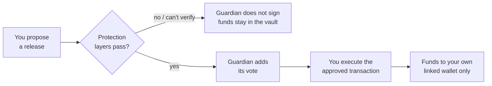
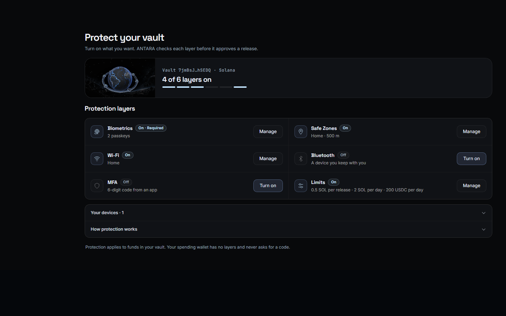
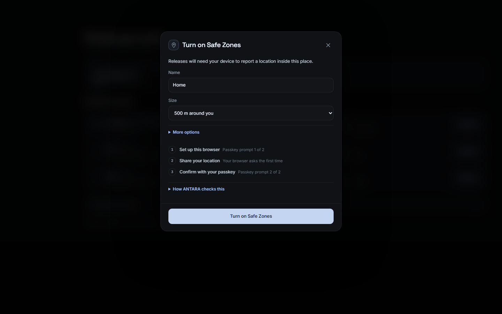
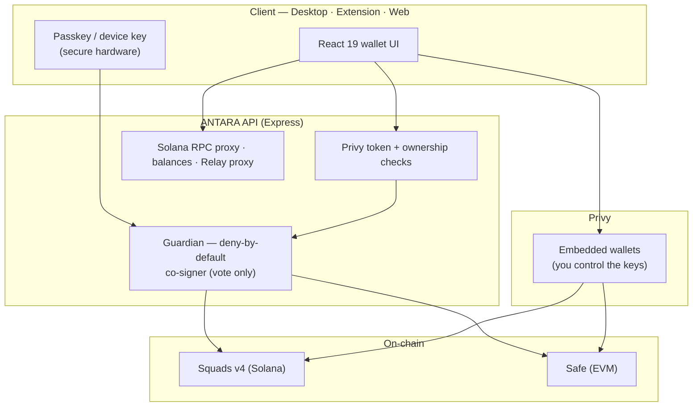

<div align="center">


<br/><br/>

**A self-custody wallet with a vault that takes more than one signature to open.**

Your everyday wallet, paired with an on-chain 2-of-2 vault that only releases funds once the protection layers *you* choose — biometrics, location, device, network, MFA, limits — all pass.

[](LICENSE)
[](#platforms)
[](#supported-networks)
[](https://antara.tech)
[](https://x.com/AntaraWallet)

<a href="https://antara.tech"><strong>Website</strong></a> ·
<a href="docs/PRODUCT.md"><strong>Docs</strong></a> ·
<a href="#how-it-works"><strong>How it works</strong></a> ·
<a href="#security-model"><strong>Security</strong></a>

</div>

---

## The problem

In self-custody, your entire balance is usually **one signature away from gone**. One phishing approval on a convincing site, one private key pasted into the wrong place, one hijacked session — any single mistake is final and irreversible. The usual "fix" is to hand your coins to a custodian and trust *their* single point of failure instead.

ANTARA takes the other path: **you keep full custody**, but the funds that matter sit behind more than one signature, more than one device, and the exact conditions you set. A phished signature isn't enough. A stolen key isn't enough. A compromised session isn't enough.

## How it works

Each account pairs a **spending wallet** (fast, one signature, for daily use) with a **vault** — an on-chain **2-of-2 multisig**. Your wallet holds one key; ANTARA's **guardian** holds the other. Neither can move the vault alone.

A release starts with *your* signature. The guardian adds the second **only after** it re-reads the vault on-chain and verifies every protection layer you enabled.



The guardian can **vote**, never **initiate** or **execute**, and releases are restricted to **your own linked wallets**. Before every deposit, proposal, approval and execution, ANTARA reads the vault from the chain again and stops if anything changed since you reviewed it. Every layer is **fail-closed**: a check that can't be verified is treated the same as one that fails.

## Protection layers

Each layer you turn on is checked at release time, bound to that exact transaction. You choose which apply.

| Layer | What it checks | Strength |
| --- | --- | --- |
| **Biometrics** | A passkey (WebAuthn) signed in your device's secure hardware. ANTARA stores only the public key — never your face or fingerprint. | Cryptographic · required |
| **MFA** | A time-based code from your authenticator app, verified at approval. Vault-only — your spending wallet stays frictionless. | Cryptographic · optional |
| **Safe Zones** | A device-reported location signed by a trusted device key, inside a place you approved — accuracy-aware, not just "inside the circle." | Device-reported · optional |
| **Wi-Fi** | The release comes from a network you trust (server-observed IP; the desktop app can also match the Wi-Fi name + access-point). | Server/device · optional |
| **Bluetooth** | A device you carry — your phone — is nearby at approval time. | Device-reported · optional |
| **Limits** | Per-release and per-day caps you set. The guardian refuses to vote above them. | Cryptographic · optional |

ANTARA labels each layer honestly: cryptographic layers can't be faked; device-reported ones (location, Wi-Fi name, Bluetooth) stop a remote attacker but are not independent proof of physical presence. See [docs/VAULT_LAYERS.md](docs/VAULT_LAYERS.md).

## Supported networks

Solana is the primary network. The vault is each chain's **established multisig standard** — not a new ANTARA contract — with ANTARA as the second signer on top.

| Network | Vault | Native | Funding stablecoin |
| --- | --- | --- | --- |
| **Solana** | [Squads v4](https://squads.so) 2-of-2 | SOL | USDC |
| **Ethereum** | [Safe](https://safe.global) | ETH | USDC |
| **BNB Smart Chain** | Safe | BNB | USDC (Binance-Peg) |
| **Robinhood Chain** | Safe | ETH | USDG |
| **Base** | Safe | ETH | USDC |

On EVM, ANTARA verifies the deployed account against Safe's published bytecode before trusting it. Token addresses and Relay routes are pinned in [`src/solares/networks.ts`](src/solares/networks.ts) — tokens are never identified by ticker alone.

## Screenshots

<div align="center">

&nbsp;

</div>

## Platforms

The same wallet ships three ways, all talking to the API at `antara.tech`:

- **Desktop** — a native [Tauri](https://tauri.app) (Rust + WebView2) app for Windows, with native WebAuthn, Wi-Fi, Bluetooth and location checks.
- **Chrome extension** — Manifest V3, opens in the browser side panel.
- **Web** — the full wallet at [antara.tech/app](https://antara.tech/app).

## Architecture



| Layer | Responsibility |
| --- | --- |
| **React 19 + Vite** | Wallet UI, rendered in the desktop app, the extension, and the web app. |
| **Tauri (Rust)** | Native desktop window and local security capabilities. |
| **Privy** | Login and embedded Solana/EVM wallets — keys stay with the user. |
| **Express API** | Verifies Privy tokens and wallet ownership, serves balances, proxies a restricted Relay route and a same-origin Solana RPC. Secrets stay server-side. |
| **Guardian** | A deny-by-default server co-signer that votes on a release only after the protection layers pass. Bounded by policy — it can never initiate or execute. |
| **Squads v4 / Safe** | The vault itself, on each chain. |

## Getting started

Requires **Node.js 22.12+**, npm. The desktop app also needs Rust/MSVC, the C++ build tools and WebView2 (packaged-app users need none of that).

```sh
git clone https://github.com/Antara-Wallet/antara.git
cd antara
npm ci
npm --prefix server ci
```

Copy the env templates and fill in your own keys (leaving the Privy values empty opens a disconnected wallet with no invented balances):

```sh
cp .env.example .env.local
cp server/.env.example server/.env
```

Run it:

```sh
npm run dev:api        # the API server
npm run dev            # the web app  (http://localhost:5173)
npm run desktop:dev    # the native desktop window
npm run build:extension   # the Chrome extension (load unpacked from dist-extension/)
```

Checks: `npm test` (unit + config + server), `npm run typecheck`, `npm run check`. More in [docs/DESKTOP.md](docs/DESKTOP.md) and [docs/EXTENSION.md](docs/EXTENSION.md).

## Project structure

```
src/            React wallet UI (shared across desktop, extension, web)
src-tauri/      Rust desktop app (native security capabilities)
extension/      Chrome MV3 entry points and side panel
server/         Express API — auth, balances, guardian, RPC & Relay proxy
scripts/        build, packaging and verification scripts
docs/           product, security, vault-layers, desktop & extension docs
tests/          unit, config and browser (Playwright) tests
```

## Security model

- **Self-custody.** Keys are generated and held in a secure enclave you control. ANTARA never receives your private keys or biometric data.
- **Two-of-two.** The guardian co-signs within your rules and can never move funds alone.
- **Fail-closed.** Any layer that can't be verified blocks the release.
- **Own-wallet destinations.** Vault releases go only to your linked wallets.
- **Honest UI.** No invented balances, prices or protection badges; device-reported checks are labelled as such.

Found a vulnerability? Please read [SECURITY.md](SECURITY.md) for responsible disclosure — **do not** open a public issue for security reports.

## Roadmap

- Gas sponsorship and broader EVM paired-vault coverage.
- A compliant, self-custodial **private vault** (a Privacy-Pools-style shielded pool whose withdrawals still pass your protection layers).
- **Quantum-resistant** signatures.

## Contributing

Contributions are welcome — see [CONTRIBUTING.md](CONTRIBUTING.md) and the [Code of Conduct](CODE_OF_CONDUCT.md). Please open an issue to discuss significant changes first.

## License

[Apache License 2.0](LICENSE) © ANTARA.

<div align="center">
<br/>
<a href="https://antara.tech"><strong>antara.tech</strong></a> · <a href="https://x.com/AntaraWallet">@AntaraWallet</a>
</div>
